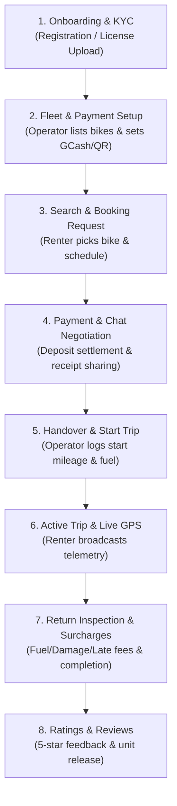

# Ride4Rent — Complete System Flow & Operation Manual

---

## 👥 System Actors & Roles

| Actor | Description & Responsibilities |
| :--- | :--- |
| **👤 Renter (Customer)** | Searches motorcycles, books rentals, settles reservation deposits, chats with operators, broadcasts live trip GPS, and reviews rentals. |
| **🏢 Operator (Vehicle Host)** | Lists motorcycle inventory, configures payment accounts (GCash/Maya/Bank & QR Code), conducts vehicle handover & return inspections, calculates surcharges, and confirms bookings. |
| **🛡️ Administrator** | Moderates platform compliance, verifies driver's licenses, and approves/rejects Operator business permits (DTI/SEC/Mayor's Permit). |

---

## 🗺️ High-Level System Lifecycle

---

## 📋 Step-by-Step Operational Instructions

### Phase 1: Onboarding, Account Setup & KYC Verification

#### For Renters:
1. **Sign Up / Login**: Register with name, email, phone number, and password, or verify with OTP.
2. **Driver's License Upload**: Submit front and back photos of your valid driver's license for administrator verification. Approval is required before booking when the admin KYC setting is enabled.
3. **Explore Ready**: Once registered, browse available motorcycles across nearby locations.

#### For Operators:
1. **Operator Registration**: Submit business name, contact info, business address, and upload government-issued business permits (DTI / SEC / Mayor's Permit).
2. **Admin Verification**: The Admin verifies business legitimacy in the Admin Dashboard and approves the account.
3. **Payment Account Setup**: The Operator goes to **Settings ➔ Payment Setup** and enters:
   - **Account Name** (e.g., *"Juan Dela Cruz"*)
   - **Account / Mobile Number** (e.g., *"0917-123-4567"*)
   - **Accepted Methods** (Cash on Handover, GCash, Maya, Bank Transfer)
   - **Payment QR Code Image** (Uploads GCash/Maya QR code for easy scanning)

---

### Phase 2: Fleet & Vehicle Management (Operator)

1. **Add Motorcycle**: Operator taps **"Add Vehicle"** in the Operator Fleet Dashboard.
2. **Enter Details**:
   - Model Name (e.g., *Honda Click 125i*, *Yamaha NMAX 155*)
   - Transmission, Engine Displacement, Fuel Capacity, Year Model, Plate Number
   - **Daily Rental Rate** (e.g., ₱600/day) and **Reservation Deposit** (e.g., ₱500)
   - **Available Quantity / Units** (e.g., 3 units)
   - High-quality vehicle photos
3. **Live Catalog**: The motorcycle immediately appears in the public rental catalog with its live available unit counter.

---

### Phase 3: Vehicle Search & Reservation Request (Renter)

1. **Browse & Filter**: The Renter searches motorcycles by location, daily price, transmission type, or date schedule.
2. **Select Motorcycle**: Renter views specs, host profile, daily rate, and rental guidelines.
3. **Select Rental Dates**: Renter chooses **Start Date** and **End Date**.
   - The system calculates total rental days, total rent, and the reservation deposit due.
4. **Submit Reservation**: Renter taps **"Book Motorcycle"**.
   - The system creates a `pending_payment` request. Inventory is reserved when payment details are submitted for host verification.
   - The backend creates a notification for the operator; the app retrieves it during its next refresh.

---

### Phase 4: Payment Settlement, In-App Chat & Operator Confirmation

1. **Open Payment Settlement**:
   - In **My Bookings**, the Renter taps **"Pay Deposit / Settle Fee"**.
   - The modal automatically displays the **Operator’s Payment Account Details** (GCash Number, Account Name, and QR Code).
2. **Chat & Coordinate**:
   - The Renter taps **"Chat with Host to Settle"**.
   - The in-app chat opens with a **Top Booking Summary Banner** showing rent breakdown and the host's payment details.
   - The Renter and Operator coordinate via chat.
3. **Send Receipt / Notice**:
   - Renter transfers the reservation deposit via GCash/Bank and taps the 📷 **Camera / Gallery** button in chat to send the payment receipt photo.
   - (Or agrees on **Cash on Handover**).
4. **Operator Confirms Payment**:
   - The Operator inspects the receipt in chat (tap to zoom full screen).
   - In **Operator Bookings**, the Operator taps **"Confirm Payment Received & Approve"**.
   - The booking status updates to `approved` and `payment_status: paid_reservation`.
   - **App Alert**: The renter receives a device alert after the app fetches the new notification: *"🎉 Payment Confirmed & Booking Approved! Ready for pickup."*

---

### Phase 5: Vehicle Handover & Start Trip Inspection

1. **Meetup & Handover**: Renter and Operator meet at the agreed pickup location.
2. **Operator Handover Inspection**:
   - Operator opens the booking and taps **"Start Trip / Handover"**.
   - Logs **Starting Odometer Mileage** (e.g., 12,450 km).
   - Logs **Starting Fuel Level** (e.g., 100% full tank).
   - Takes photos of existing vehicle conditions/scratches.
3. **Trip Started**:
   - Operator confirms handover. Status updates to `trip_in_progress`.
   - The Renter's app switches to **Active Rental Mode**.

---

### Phase 6: Active Trip & Real-Time GPS Telemetry

1. **Live GPS Sync**:
   - While the trip is active, the Renter’s phone broadcasts GPS coordinates using a background location task in an installed build with background location permission; otherwise the app uses foreground updates. Telemetry includes (latitude, longitude, speed, and current street address) to the backend.
2. **Fleet Tracking (Operator)**:
   - The Operator can tap **"Track Location"** on any active trip to view the motorcycle's live position on the map.
3. **Rental Extension (Optional)**:
   - If the Renter needs more time, they tap **"Request Extension"** and pick additional days.
   - The Operator reviews and taps **"Approve Extension"**, allowing the renter to submit extension payment details. The return date and invoice update after the operator confirms receipt.

---

### Phase 7: Return Inspection, Surcharges & Trip Completion

1. **Return Meetup**: The Renter returns the motorcycle to the Operator at the scheduled end time.
2. **Operator Return Inspection**:
   - The Operator opens the booking and taps **"Return Inspection / Complete Trip"**.
   - Enters **Ending Odometer Mileage** (system calculates distance traveled).
   - Enters **Ending Fuel Level** (e.g., 50%).
   - Inputs any applicable **Surcharges**:
     - ⛽ **Fuel Surcharge**: If returned with missing fuel.
     - 🛠️ **Damage Surcharge**: If any new dents/scratches occurred.
     - ⏰ **Late Return Fee**: If returned past the scheduled end time.
     - 📦 **Other Charges**: Custom fees (e.g., lost helmet, unpaid tolls).
3. **Final Balance Computation**:
   $$\text{Final Balance Due} = (\text{Total Rental} - \text{Deposit Paid}) + \text{Total Surcharges}$$
4. **Complete Trip**:
   - Renter pays the remaining balance to the Operator (Cash / GCash).
   - Operator taps **"Complete Trip"**.
   - Status updates to `completed` and `paid_full`.
   - The vehicle unit is automatically released back to the available fleet inventory (`available_units + 1`).

---

### Phase 8: Ratings, Reviews & Notifications

1. **Rate & Review**:
   - The Renter receives a prompt to rate the rental experience (1 to 5 stars) and write feedback.
   - Reviews are publicly displayed on the motorcycle's profile.
2. **Notifications History**:
   - All booking updates, payment confirmations, trip starts, and approvals are logged in the **Notification Center** and retrieved by polling, with local device alerts and scheduled reminders. Server-to-device remote push delivery is not currently configured.

---

### Phase 9: Admin Compliance & Moderation Flow

1. **Admin Dashboard**: Administrator logs in to oversee platform health.
2. **Review Pending KYC**: Admin reviews uploaded driver's licenses and operator business permits.
3. **Approve / Reject**: Admin grants official verified host badges or provides rejection reasons if documents are invalid.
4. **Platform Audits**: Admin monitors active rentals, fleet stats, and user accounts.

---

## 📊 Level 1 Data Flow Diagram (DFD Reference)

```mermaid
flowchart TD
    %% Styling
    classDef entity fill:#FFFFFF,stroke:#1E293B,stroke-width:2px,color:#0F172A,font-weight:bold;
    classDef process fill:#E0F2FE,stroke:#0284C7,stroke-width:2px,color:#0369A1,rx:12,ry:12;
    classDef datastore fill:#CCFBF1,stroke:#0D9488,stroke-width:2px,color:#115E59;

    %% Entities
    User["User (Renters and Operators)"]:::entity
    Admin["Admin"]:::entity

    %% Processes
    P1["<b>1</b><br/><b>Access Application</b><br/>(Sign up / Login / KYC)"]:::process
    P2["<b>2</b><br/><b>Browse & Manage Fleet</b><br/>(View Motorcycles / Inventory / Rates)"]:::process
    P3["<b>3</b><br/><b>Messages & Payment Settlement</b><br/>(In-App Chat, Receipt Sharing, QR Code)"]:::process
    P4["<b>4</b><br/><b>Trip & Telemetry</b><br/>(Handover, Live GPS Tracking, Return Surcharges)"]:::process
    P5["<b>5</b><br/><b>Search & Filter</b><br/>(Explore Motorcycles by Location / Type)"]:::process
    P6["<b>6</b><br/><b>Profile & Payment Settings</b><br/>(Host GCash/Bank Setup, Renter Details)"]:::process
    P7["<b>7</b><br/><b>Notifications & Reviews</b><br/>(Push Alerts, System Updates & Ratings)"]:::process

    A1["<b>1</b><br/><b>User & Account Management</b>"]:::process
    A2["<b>2</b><br/><b>Admin Moderation</b><br/>(Approve Licenses & Permits)"]:::process
    A3["<b>3</b><br/><b>Analytics & Platform Data</b>"]:::process

    %% Data Stores
    D1[("<b>D1</b><br/><b>User & KYC Data</b>")]:::datastore
    D2[("<b>D2</b><br/><b>Fleet & Vehicle Data</b>")]:::datastore
    D3[("<b>D3</b><br/><b>Bookings & Trip Data</b>")]:::datastore
    D4[("<b>D4</b><br/><b>Messages & Media Data</b>")]:::datastore
    D5[("<b>D5</b><br/><b>Notifications & Reviews Data</b>")]:::datastore

    %% Flows
    User -->|"Login / Sign Up"| P1
    P1 <--> D1

    User -->|"Browse / Manage Motorcycles"| P2
    P2 <--> D2

    User -->|"Access Chat / Settle Payment"| P3
    P3 <--> D4
    P3 <--> D1
    P3 --> D3

    User -->|"Start / Track / End Trip"| P4
    P4 <--> D3
    P4 --> D2

    User -->|"Search Motorcycles"| P5
    P5 <--> D2

    User -->|"Manage Profile & Payment Setup"| P6
    P6 <--> D1

    User -->|"Get Updates & Alerts"| P7
    P7 <--> D5

    Admin -->|"Login"| A1
    Admin -->|"Moderate KYC & Permits"| A2
    Admin -->|"View System Analytics"| A3

    A1 <--> D1
    A2 <--> D1
    A3 <--> D3
```

